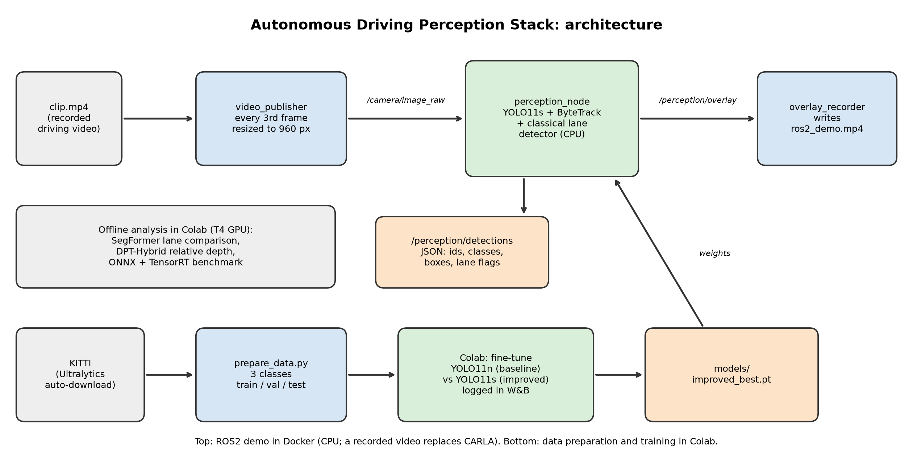

# Autonomous Driving Perception Stack

A vision pipeline that detects lanes, vehicles, and pedestrians, tracks them,
estimates distance, and runs on a camera feed through ROS2.

## Architecture

Topics, message formats and file formats: see [docs/api.md](docs/api.md).

**Status:** In progress (started 30 Oct 2026)

## Stack
Python, Ultralytics YOLO11, ByteTrack, OpenCV, SegFormer (Hugging Face), DPT-Hybrid (MiDaS family), ONNX, TensorRT, ROS2 Humble (Docker), Weights & Biases, Google Colab.
## Dataset
KITTI (Karlsruhe Institute of Technology / Toyota Technological Institute), loaded via Ultralytics.

BDD100K's official portal was unavailable on 2 Nov 2026 and its label files were not obtained in time, so KITTI (listed in the assignment) was used for training.

### Class imbalance (EDA finding)

KITTI is heavily imbalanced: car is about 71% of all boxes, while person_sitting is about 0.5%.

Per-class metrics are therefore reported, not only an overall score.

## Setup
Developed on a MacBook (Apple M2) with Python 3.14 in VS Code. GPU steps ran on Google Colab (T4).
ROS2 Humble runs in Docker. Data, model weights and videos are NOT in the repository (size/licence);
the weights (`models/improved_best.pt`) are in the Drive submission folder.

1. Environment
```
python3 -m venv .venv
source .venv/bin/activate
pip install -r requirements.txt
```
(`requirements-lock.txt` lists the exact versions used.)

2. Data (KITTI via Ultralytics, ~390 MB, downloads automatically) and 3-class splits
```
python src/eda_kitti.py --out results/eda
python src/prepare_data.py --out data/processed/kitti3
```
3. Training, lane segmentation, depth, ONNX/TensorRT benchmark: run notebooks 01 to 04 in Google Colab
(T4 GPU). Upload `kitti3.zip` to Drive first. The Weights & Biases key goes in Colab Secrets (never in code).

4. Tracking and lane detection on a driving video (needs `data/raw/videos/clip.mp4` and `models/improved_best.pt`)
```
python src/tracking/track_video.py --weights models/improved_best.pt --video data/raw/videos/clip.mp4 --out results/tracking
python src/lanes/classical.py --video data/raw/videos/clip.mp4 --out results/lanes --roi-bottom-y 0.70
```
5. ROS2 demo (Docker)
```
docker build -t driving-perception-ros2 docker/
docker run --rm -it --name ros-demo -v "$(pwd)":/ws -w /ws driving-perception-ros2 bash
bash scripts/run_ros2_demo.sh        # inside the container; add "40" for a short test
```
Topics: /camera/image_raw (sensor_msgs/Image), /perception/overlay (sensor_msgs/Image),
/perception/detections (std_msgs/String, JSON). Output: results/ros2/ros2_demo.mp4.

6. Tests
```
python -m unittest discover -s tests -v
# inside the Docker container:
source /opt/ros/humble/setup.bash && python3 -m unittest discover -s tests/ros2 -v
```
Test video source and licence: Pexels, "Busy Urban Traffic View from a Car" by Jabriel. Free under the Pexels License. Source: https://www.pexels.com/video/busy-urban-traffic-view-from-a-car-31901299/


## Detection results (YOLO, KITTI, 3 classes)
Classes: vehicle (car, van, truck, tram), pedestrian (pedestrian, person_sitting), cyclist.
`misc` dropped. Splits: train 5,485 / val 500 (random slice of KITTI train) / test 1,496
(official KITTI val, never used for tuning).

| Class | Baseline YOLO11n (10 ep) mAP50 / recall | Improved YOLO11s (30 ep) mAP50 / recall |
|---|---|---|
| vehicle | 0.887 / 0.788 | 0.959 / 0.904 |
| pedestrian | 0.584 / 0.514 | 0.753 / 0.621 |
| cyclist | 0.493 / 0.440 | 0.780 / 0.702 |
| **all (mAP50)** | **0.655** | **0.831** |
| **all (mAP50-95)** | **0.374** | **0.556** |

The improved model changes two things at once (larger model and longer training), so the gain
cannot be attributed to either alone. Single run per model. Pedestrian recall is the weakest
point (0.621): about 4 in 10 pedestrians are missed. Training runs are logged in Weights & Biases.


## Object Tracking (YOLO + ByteTrack)

### Tracking Results

The tracking pipeline was tested on a driving video containing multiple vehicles. It processed 1,537 frames and generated 6,857 tracking records with 73 unique track IDs.

During visual inspection, vehicles generally retained their assigned IDs while visible. No clear ID switches were observed during the inspection.

The tracker assigned non-consecutive IDs, such as 11, 25, 31 and 250. These numbers represent tracking identifiers, not the total number of vehicles.

A total of 18 tracks lasted fewer than five frames. 

Tracking run: improved YOLO11s weights, imgsz=640, conf=0.25, ByteTrack (Ultralytics default tracker settings), all 1,537 video frames processed.

Observed issues: Tracking boxes overlap in crowded areas, which makes it hard to tell which box belongs to which vehicle. ID switches were not counted (there are no tracking ground-truth labels); the statement above that no clear ID switches were seen comes from visual inspection of parts of the video.

**Output files:**
- `tracked.mp4` – Annotated tracking video.
- `tracks.csv` – Tracking information for detected objects.
- `summary.json` – Tracking statistics.

## Lane detection: classical vs segmentation
Classical: OpenCV (white/yellow paint mask, Canny edges, Hough lines, smoothing). Both lanes
detected in 97.7% of 1,537 video frames (detection rate, not accuracy).
Segmentation: pretrained SegFormer-B0 (Cityscapes, nvidia/segformer-b0-finetuned-cityscapes-1024-1024),
used as-is. It predicts the road surface, not individual lane markings, so the methods answer related
but different questions. Compared on the same 20 frames: 99.8% of classical line pixels fall on
predicted road. This is a sanity check, not accuracy: any line on a wide road scores high, and no
ground-truth lane labels were used.
Observed failure cases: In some frames, the segmentation mask includes parts of the vehicle hood and nearby roadside areas, incorrectly classifying them as road. The classical lane detection method also struggles with curved turn lanes because straight-line detection cannot follow curves accurately.

## Depth and distance
Monocular depth: Intel/dpt-hybrid-midas (MiDaS-family, zero-shot) combined with YOLO boxes.
Output is RELATIVE distance (NEAR/MID/FAR, arbitrary cut-offs), not metres: the camera is
uncalibrated, so metric distance was not measured.
Detector settings: the first run at imgsz=640, conf=0.25 drew no boxes on the three sample frames
I inspected; rerunning at imgsz=1280 gave 129 detections over the 20 sample frames. The tracking
run at 640 produced detections over the full video, so the 640 vs 1280 difference was not
quantified. This clip is wide-angle and differs from KITTI (domain gap).
Cross-check on 20 frames (129 objects, all frames with 3+ objects): mean Spearman correlation
between depth ordering and box-bottom position = 0.92 (median 0.96). This shows the depth
ordering is consistent with a flat-road geometric cue; it is not a measurement of distance
accuracy, and monocular depth models learn the same cue, so the agreement is partly expected.
Small sample, single clip. Failure case: dense distant traffic produces overlapping tiny boxes
with unreliable labels.
## Optimization: ONNX and TensorRT benchmark
Model: improved YOLO11s (KITTI, 3 classes), exported to ONNX and TensorRT FP16 (imgsz 640).
GPU: Tesla T4 (Google Colab). 300 KITTI test images, after 10-20 warm-up images.

| Format | Median inference (ms) | FPS | End-to-end (ms/image) | Test mAP50 | Test mAP50-95 |
|---|---|---|---|---|---|
| PyTorch FP32 | 8.34 | 119.9 | 13.38 | 0.831 | 0.556 |
| ONNX Runtime (GPU) | 8.98 | 111.4 | 15.08 | 0.831 | 0.560 |
| TensorRT FP16 | 2.74 | 364.5 | 9.12 | 0.829 | 0.557 |

TensorRT FP16 was about 3x faster than PyTorch at the model step and about 1.5x faster end to
end, with no meaningful accuracy change (mAP differences of 0.002 or less). ONNX Runtime gave no
speed-up in this setup (not investigated). Caveats: one run on a shared free Colab GPU, so
results vary between sessions; "inference" excludes image reading and pre/post-processing
(the end-to-end column includes them); a TensorRT engine only runs on the GPU type it was built on.
Note: in an earlier run the Colab session crashed while loading ONNX after TensorRT had updated
packages mid-session; a clean rerun worked.

## ROS2 pipeline (recorded video replaces CARLA)
Three ROS2 Humble nodes run in Docker on CPU: `video_publisher` plays the clip as a camera
(/camera/image_raw, every 3rd frame, 960 px wide), `perception_node` runs the improved YOLO11s with
ByteTrack plus the classical lane detector and publishes /perception/overlay and /perception/detections
(JSON), and `overlay_recorder` writes results/ros2/ros2_demo.mp4.
Full run: 512 frames processed, 51 s output video. Average YOLO+tracking time over the logged frames:
213 ms per frame (results/ros2/perception.log). Not real time (CPU in Docker).
Demo video: demo/ros2_pipeline_demo.mp4 in the Drive submission folder.
Observed issues: Some green bounding boxes and vehicle labels overlap in crowded traffic, making it difficult to tell which label belongs to which vehicle. Because only every 3rd video frame is used, track IDs
may be less stable than in the full-frame-rate tracking run (not measured).

## Deviations and limitations
- Dataset: KITTI instead of BDD100K (official portal unavailable on 2 Nov 2026; label files not obtained).
- Simulator: CARLA was not used (no NVIDIA/Linux machine available). A recorded driving video is streamed
  through ROS2 instead, as permitted in Nexvia's written reply (docs/).
- The ROS2 pipeline runs on CPU in Docker, so it is not real time: frames are resized to 960 px wide and
  every 3rd video frame is used.
- Depth (MiDaS family) ran offline in Colab, not inside the ROS2 pipeline; it gives relative distance only
  (no metres; the camera is uncalibrated).
- TensorRT needs an NVIDIA GPU, so the TensorRT benchmark ran on Colab, not on the Mac.
- Lane segmentation uses a pretrained model as-is (road surface, not lane markings). No ground-truth lane or
  tracking labels were used, so lane and tracking results are qualitative or detection rates only.
- Classes merged to vehicle / pedestrian / cyclist (misc dropped). Single training run per model.